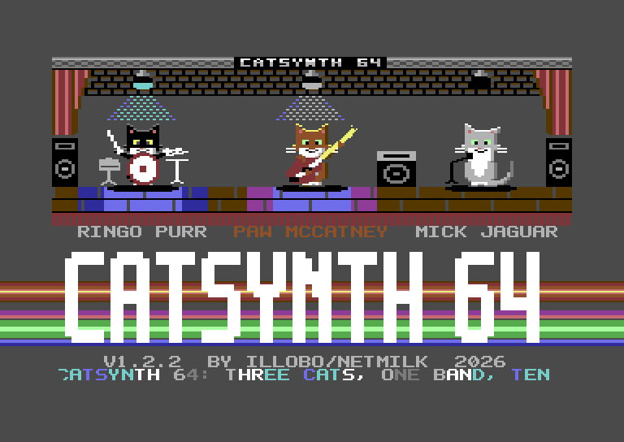

# CatSynth 64

A groovebox for the Commodore 64 with a band of three cats: Ringo Purr on
drums, Paw McCatney on bass and Mick Jaguar, who sings in meows.

**[Play it in the browser](https://illobo.github.io/catsynth64/play/)** ·
**[Website](https://illobo.github.io/catsynth64/)** ·
**[Tutorial](https://illobo.github.io/catsynth64/tutorial.html)** ·
**[Manual](https://illobo.github.io/catsynth64/manual.html)** ·
**[Download the disk](https://illobo.github.io/catsynth64/download/catsynth64-1.2.2.d64)**

- Ten styles, from dancehall and dub to acid, disco and Neko Trap, each with
  its own kit, bass sound, scale and four-bar song.
- Ten song slots on the keys 1-0; SHIFT+1-0 gives a song another style's
  sounds.
- A clickable panel (1351 mouse in port 1, or a USB mouse on the C64
  Ultimate; a joystick in port 2 works as the pointer).
- Fourteen drum sounds, a bass with slides, and meows that always land on
  the song's scale, with Bend, Vowel and Tone for each kind of meow.
- Settings pages: sidechain, kit tune, bass level, wave, Meowize (the bass
  through the singer's filter), an acid squelch, Cat Size.
- A second SID (at $D420) adds dub echoes, a harmony singer and a bass delay
  with a resonant dub filter.
- Live pads and a looper; a disk page with a directory, load, save and
  delete; ten techno songs on the disk.

Runs on a PAL Commodore 64, a C64 Ultimate / Ultimate 64 and in VICE
(x64sc). Version 1.2.2, 2026.

## Building

All you need is [64tass](https://sourceforge.net/projects/tass64/):

    make            # build/catsynth.prg: LOAD and RUN it
    make packed     # build/catsynth64.prg, packed with Exomizer 3, as released
    make web        # build/catsynth-web.prg: the web edition (the browser has
                    # no disk drive): the ten techno songs in the song slots

Or without make: `64tass -C -a src/catsynth.asm -o catsynth.prg`.

## Layout

    src/        the program, 6502 assembler: catsynth.asm includes the rest
                (sfx: the sound player, pitch: the meows, seq: the
                sequencer, sid2: the second SID, screen and title: the
                stage, disk and diskui: songs on disk, ui: the panel,
                slots: the ten song slots)
    gen/        tables the program includes, made by the author's tools:
                the ten styles (kits, basses, scales, songs), the stage and
                title graphics, the ten techno songs (for the web
                edition), and the UI font
    docs/       the website (GitHub Pages): the tutorial, the manual, the
                browser version and the downloads (the disk, with ten
                techno songs, and the program)

## Credits

- Code, music and graphics: illobo/netmilk.
- [UI Font V2](https://csdb.dk/release/?id=224117) by Scrap / Genesis
  Project, free to use (gen/uifont.txt).
- The website uses [C64 Pro Mono](https://style64.org/c64-truetype) by
  Style64 (docs/fonts) and the browser version runs on
  [floooh's chips](https://github.com/floooh/chips) C64 emulator (zlib and
  MIT, docs/play/LICENSE-chips*.txt).

## Licence

MIT, see [LICENSE](LICENSE).
